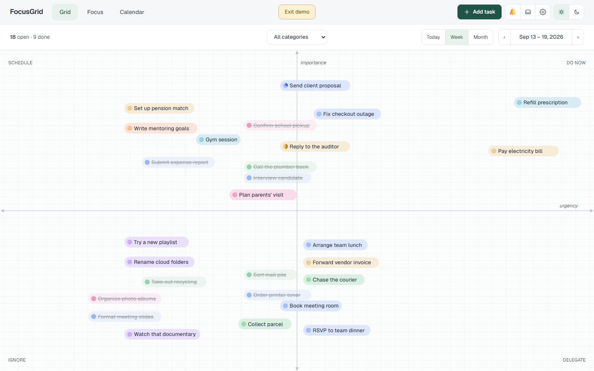
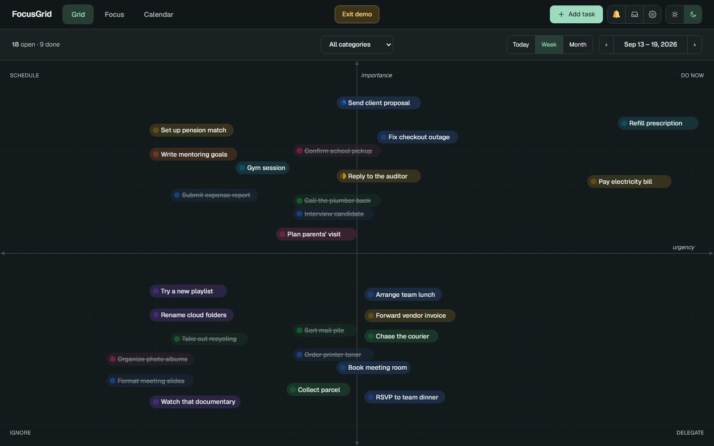
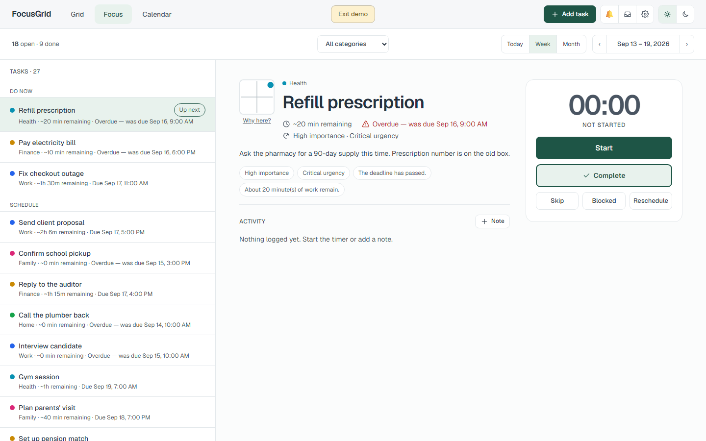
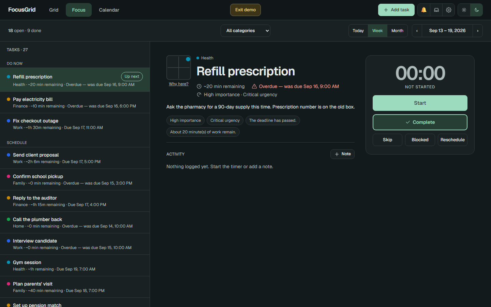
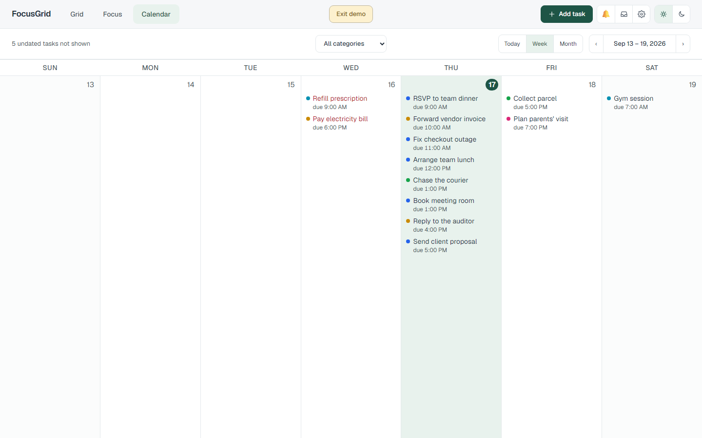
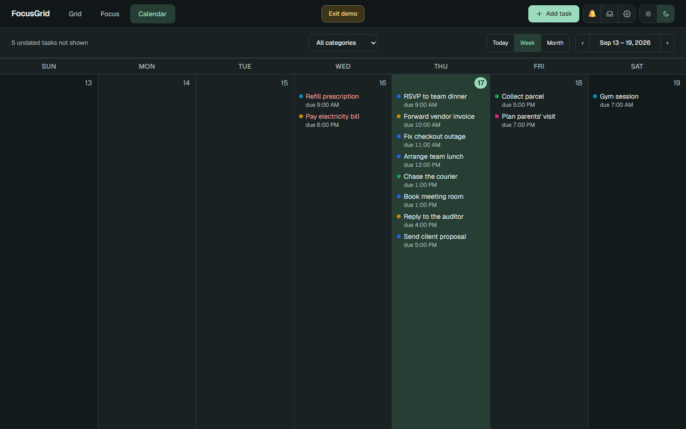

# FocusGrid

> **A task manager where position is priority.**

Every task is a point on a two-dimensional field: how far right it sits is how
*urgent* it is, how far up is how *important*. As deadlines approach, points
drift right on their own. When you don't know what to do next, **Focus** picks
one task and tells you why.

**Everything stays in your browser.** No account, no sync, no tracking. AI capture,
reminders, and calendar feeds are optional and off until you turn them on.

## How it works

- **Priority is a place, not a number.** You read the whole field at a glance
  instead of scanning a sorted list. Dragging a task is a judgement you can see.
- **Time moves tasks, you move importance.** Deadline, remaining effort, and
  overdue time set the horizontal position. How much something matters is
  yours alone; the app never changes it.
- **One recommendation, with its reasons.** Focus shows one actionable task,
  why it is up next, and a timer — not a queue.
- **Nothing is hidden.** The Inbox always lists every unfinished task, even the
  blocked and deferred ones.

## Get started

[Documentation](./docs/README.md) ·
[Grid](./docs/grid.md) ·
[Focus](./docs/focus.md) ·
[Calendar](./docs/calendar.md) ·
[Backup and import](./docs/backup-and-import.md) ·
[Demo mode](./docs/demo-mode.md)

## See it in action

### Grid — the field

Tasks are pills on an urgency × importance field. The four regions are labelled
**Do now**, **Schedule**, **Delegate**, and **Ignore**. Pan and zoom to
unclutter. Drag a pill to pin your own value on either axis; the automatic
value resumes when you reset it. Colour is the task's context (Work, Home,
Family, …).

<table>
  <tr>
    <td width="50%" valign="top"></td>
    <td width="50%" valign="top"></td>
  </tr>
</table>

### Focus — one task, and why

The pick is marked **Up next**, with its context, remaining effort, deadline
state, and a *Why here?* explanation. A timer offers **Start**, **Complete**,
**Skip**, **Blocked**, and **Reschedule**. Skipping moves on without penalty;
blocking hides the task from Focus until you unblock it.

<table>
  <tr>
    <td width="50%" valign="top"></td>
    <td width="50%" valign="top"></td>
  </tr>
</table>

### Calendar — deadlines by day

A day, week, or month grid of unfinished tasks by deadline. Overdue tasks are
red. Subscribed public calendars (holidays, fixtures, local events) appear as
read-only overlays so you can see a deadline next to what else is happening
that day.

<table>
  <tr>
    <td width="50%" valign="top"></td>
    <td width="50%" valign="top"></td>
  </tr>
</table>

## Try it in two minutes

Requires Node `>=24` and npm `>=11`. No API key needed.

```bash
npm ci
```

```bash
npm run dev
```

Open [localhost:3000](http://localhost:3000), then **Explore the demo** or
**Add task**. The demo uses a separate database and never touches your own
tasks.

## What it does

| Feature | In short |
| --- | --- |
| **[Grid](docs/grid.md)** | Tasks as points on an urgency × importance field. Pan, zoom, drag a point to pin your own judgement. |
| **[Priority engine](docs/priority-engine.md)** | Tasks move right as deadlines approach, faster when a lot of work remains. Same inputs, same result, every time. |
| **[Focus](docs/focus.md)** | One recommended task, a "why now" explanation, a timer, and Skip / Complete / Blocked / Reschedule. |
| **[Calendar](docs/calendar.md)** | Day / week / month view of deadlines with optional read-only public calendar overlays. |
| **[Tasks & Inbox](docs/tasks-and-inbox.md)** | Create, edit, block, complete, archive, restore. Searchable list of everything unfinished. Full change history per task. |
| **[Backup & import](docs/backup-and-import.md)** | Export everything as JSON; import from a backup with a preview first. Delete-all requires typing `DELETE ALL`. |
| **[Notifications](docs/notifications.md)** | Opt-in, in-app by default, quiet hours, one alert per event — never a burst. |
| **[Offline & install](docs/offline-and-mobile.md)** | Works offline after the first load; installable as an app; Focus-first layout on phones. |
| **[AI capture](docs/ai-capture.md)** | Optional. Type a sentence, let a model propose deadline, estimate, and importance — you confirm every value. |
| **[Settings](docs/settings.md)** | Contexts (colour-coded life areas), time zone, light/dark theme. |
| **[Everything else](docs/more-features.md)** | Start dates, recurrence, subtasks, dependencies, delegation, tags, templates, stats, undo, four UI languages, Markdown notes, ICS + Google Calendar, push reminders, webhooks, CSV / Todoist / Google Tasks import, chat assistant, Telegram capture bot. |

## Your data

FocusGrid keeps tasks in the browser's own storage, for **one browser profile
on one website address**. Another browser, device, or private window starts
empty, and the browser's "clear site data" erases everything without warning.
**Export a backup** from Settings regularly; it is a plain JSON file you can
re-import anywhere.

<details>
<summary><strong>For developers</strong></summary>

<br />

**Stack:** [Next.js 16](https://nextjs.org) (App Router) + React 19 +
TypeScript · Tailwind CSS 4 · IndexedDB via
[`idb`](https://github.com/jakearchibald/idb) · [Zod](https://zod.dev) at every
trust boundary · Vitest + Playwright · ESLint with domain-boundary rules.

**Layout:**

```
src/
  domain/        pure logic: task model, deadline math, priority formula, Focus ranking, ICS parsing
  application/   commands and queries, heartbeat, focus session, demo seed, assistant client
  persistence/   IndexedDB repository, migrations, export/import, importers
  ai/            server-only: capture interpreter, model-agnostic LLM turn, assistant tool contract
  push/          server-only push-reminder scheduler
  telegram/      server-only Telegram capture bot
  grid/          field geometry, labels, pan/zoom transforms
  app/           Next.js routes, API routes, and React components
e2e/             Playwright specs
docs/            user guides and screenshots
```

`src/domain` may not import React, Next, browser globals, storage, or
environment variables — ESLint enforces it. The UI never re-implements the
priority formula; it only renders what the domain computes.

**Scripts:**

| Command | Purpose |
| --- | --- |
| `npm run dev` | Development server on port 3000 |
| `npm run build` / `npm run start` | Production build / serve |
| `npm run lint` | ESLint, including the domain-boundary rules |
| `npm run typecheck` | `tsc --noEmit` |
| `npm test` | All Vitest suites |
| `npm run test:e2e` | Playwright browser tests (`npx playwright install` once) |

Optional server-side pieces (AI capture, chat assistant, Telegram bot, push
reminders, `.ics` feed proxy) are enabled by environment variables listed in
[`.env.example`](.env.example). Without them every local feature works.

</details>

## Contributing

See [CONTRIBUTING.md](CONTRIBUTING.md) for local checks, testing requirements,
and pull request guidance.

## Questions and feedback

To report a bug or ask a question, use [SUPPORT.md](SUPPORT.md) and the issue
forms. Report a security concern using [SECURITY.md](SECURITY.md).
User-visible changes are recorded in [CHANGELOG.md](CHANGELOG.md).

## Copyright

Copyright © 2026 Gautam Kolan. All rights reserved.
