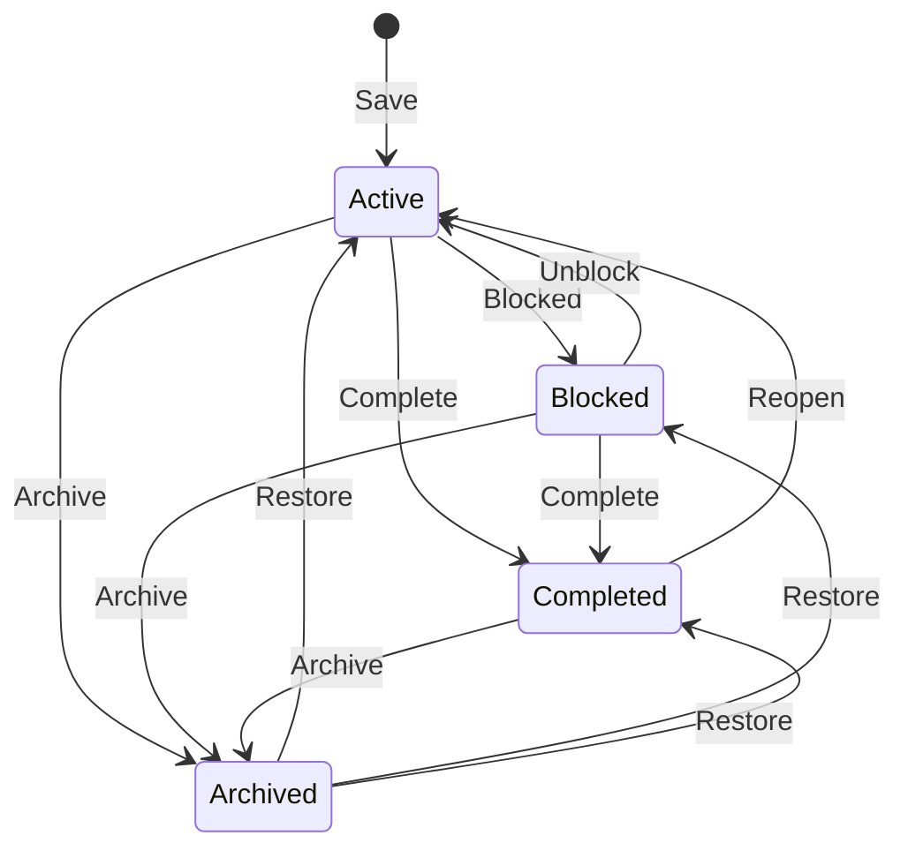

# Tasks and Inbox

## A task

| Field | Notes |
| --- | --- |
| **Title** | Required, up to 200 characters. |
| **Notes** | Free text. Never shown in notifications. |
| **Deadline** | **No deadline**, **A day** (due at the next midnight in the stored zone), or **A day & time**. The time zone is stored with the deadline and never rewritten. |
| **Estimate (minutes)** | Optional. Drives effort pressure and "remaining" text. |
| **Context** | One of your contexts, or Uncategorized. |
| **Importance** (create only) | Low / Medium / High. Leaving Medium untouched keeps importance automatic; choosing anything — including Medium — pins it. |
| **Progress** (edit only) | 0–100 %. Complete sets it to 100; reopen restores the previous value. |

Every saved value records where it came from (you, the engine, or an accepted
AI proposal) and when.

## Adding a task

**Add task** in the header (or the **+** on phones) opens the dialog. Fill in
a title — everything else is optional — and press **Save**. The task appears
on the Grid at once: undated tasks at the default low urgency, dated tasks
wherever the [priority engine](priority-engine.md) puts them.

If [AI capture](ai-capture.md) is enabled, the button reads **Save without
AI** and an **Interpret with AI** button sits beside it.

## Editing a task

Open a task from the Grid (double-click, or **Edit task** in the details
panel), Focus (**Reschedule**), or the Inbox (click the row). The edit dialog
adds:

- **Progress** with a **Set progress** button.
- Per-axis **Reset to automatic** when urgency or importance is pinned.
- Lifecycle buttons for the task's current status (below).
- **History** — a collapsible list of meaningful changes with their reason and
  the urgency/importance at that moment.
- **Danger zone** → permanent delete, behind a browser confirm.

A **completed** task's deadline, estimate, and context are read-only; reopen
it to change them.

## Lifecycle

**Restore** returns a task to whatever status it had when archived. **Reopen**
a completed task and its earlier partial progress comes back. Nothing moves
between these states on its own — being overdue, even for weeks, never
archives or deletes a task.

## Inbox

The Inbox lists **every unfinished task**, including blocked, deferred, and
needs-review ones, so nothing can hide behind a crowded field.

- **Search** matches title and notes.
- Tabs: **All unfinished** · **Completed** · **Archive** · **Review**.
- Each row shows the context, urgency/importance labels, deadline text, and
  progress if started, plus a status chip (*Blocked*, *Starts later*, *Needs
  review*) where relevant.

### Review tab

Tasks overdue by more than seven days land here and leave Focus. Each row
offers four one-click decisions:

| Button | Effect |
| --- | --- |
| **Complete** | It got done after all. |
| **Blocked** | Mark it blocked until you can act. |
| **No longer needed** | Archive it. |
| **Still relevant** | Postpone the review by seven days; the task returns to Focus. |

Or open the row and give it a new deadline.

## History

The app appends a snapshot when you create, edit a deadline, change progress,
pin or reset an axis, or accept an AI proposal, and whenever time alone has
moved a task's position by at least 0.05 on either axis since the last
snapshot. Each task keeps its first snapshot plus the newest 499; the dialog
says how many older ones were pruned.

## Two tabs at once

If two tabs edit the same task, the second save is rejected with *"This task changed elsewhere"* rather than
silently overwriting; reload and try again. Saving twice is harmless — a
double-click on **Save** creates one task, not two.

## What can go wrong

| Problem | What it means | What to do |
| --- | --- | --- |
| "This task changed elsewhere" | Another tab saved first. | Reopen the task and repeat the change. |
| Deadline fields are greyed out | The task is completed. | **Reopen**, edit, **Complete** again. |
| A task is in the Inbox but not on the Grid | Grid shows unfinished tasks only; the Inbox's Completed and Archive tabs are lists, never quadrants. | Expected. |
| "Nothing here yet." | No tasks match the tab and search. | **Clear filters** or add a task. |

## Limits

- Subtasks, recurrence, dependencies, delegation, tags and a manual start date
  are described in [More features](more-features.md). The **Delegate** quadrant is still a
  label; delegation records a name, it does not message anyone.
